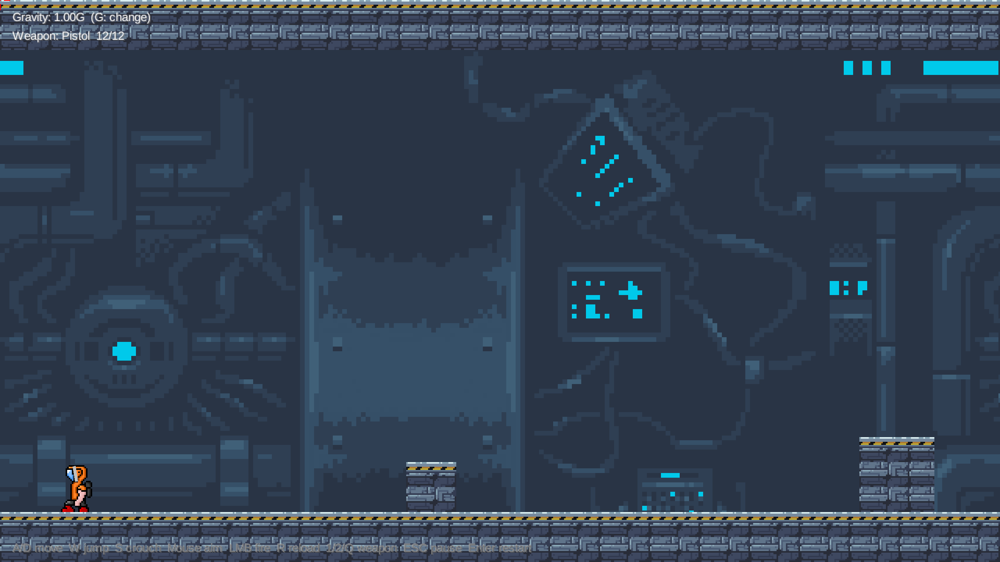
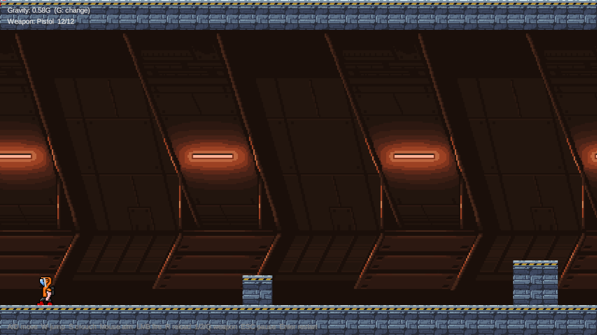
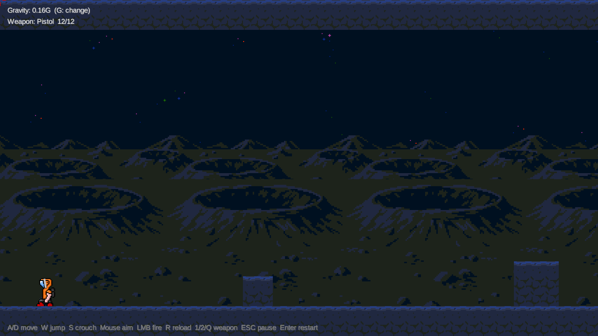
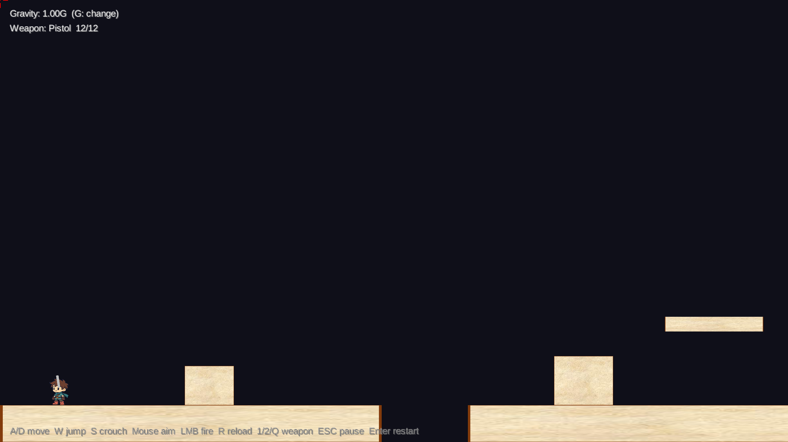
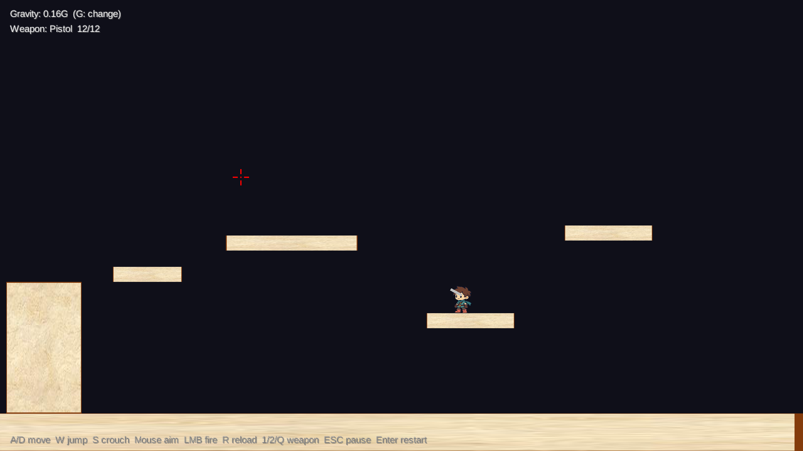
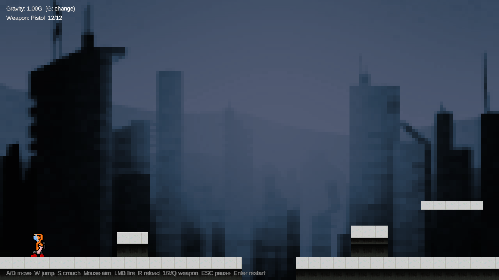
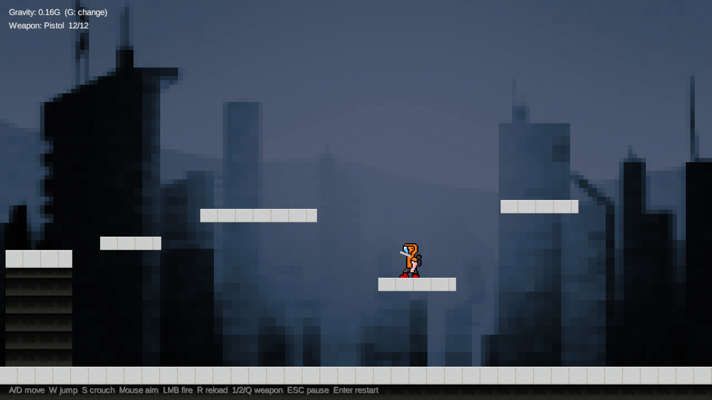
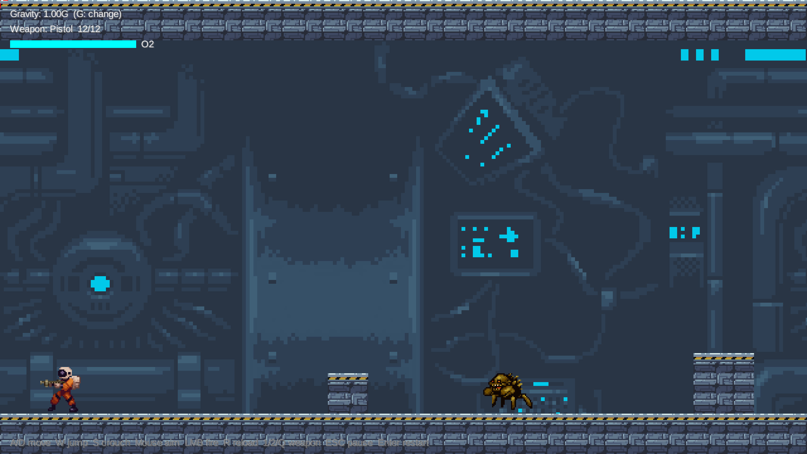
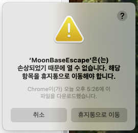
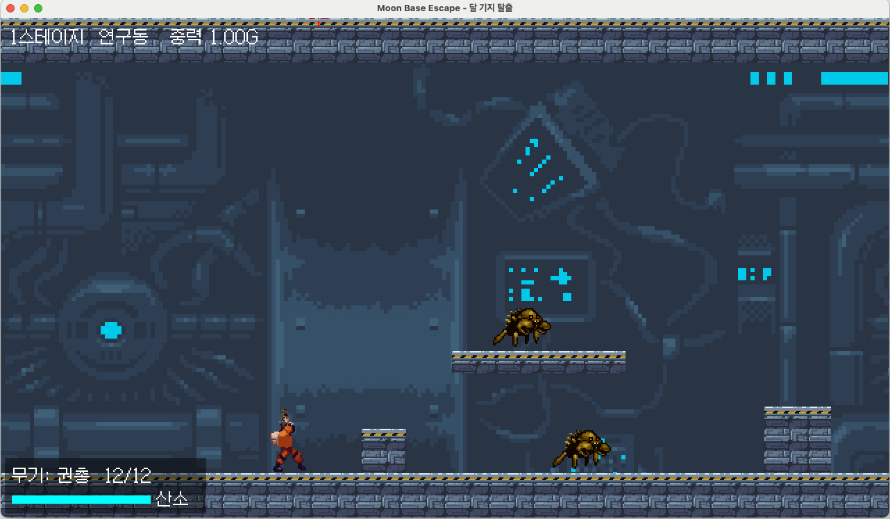

# 개발 일지 — 게임 및 혼합현실 중간 프로젝트

레포트·발표 자료용 기록. 결정한 것, 그 이유, 확인한 방법을 날짜순으로 남긴다.
계획과 일정은 [PLAN.md](../PLAN.md), 실행 방법과 에셋 출처는 [README.md](../README.md).
---

## 1. 게임 개요

**장르:** 2D 런앤건 플랫포머 (메탈슬러그 계열)
**스토리:** 달 연구기지에서 연구하던 주인공이 갑자기 들이닥친 괴물을 피해, 지구로 돌아갈 탈출포드까지 가는 여정.

| 스테이지 | 장소 | 중력 | 설정상 이유 |
|---|---|---|---|
| 1 | 연구동 | 1.0G | 기지 인공중력 정상 작동 |
| 2 | 붕괴 구역 | 0.58G = (1G + 달)/2 | 인공중력 고장 중 |
| 3 | 달 표면 → 탈출포드 | 0.16G | 기지 밖, 달 중력 그대로 |

### 독창 요소 3개 (코드 구현)
1. **중력 연동 반동 무기** — 권총(반동 작음, 데미지 약함) / 샷건(반동 큼, 펠릿 5발). 반동은 조준 반대 방향의 고정 충격량이라, 같은 샷건이라도 중력이 약할수록 높이 뜬다 (높이 = v²/2g). 앉으면 반동 50%.
2. **산소 = 체력 + 누출** — 피격 시 산소 감소 + 우주복 누출 단계 증가, 누출은 진공에서만 산소를 뺌. 산소 스테이션에서 충전·수리.
3. **감압 창문** — 창문 내구도를 맞은 탄 수만큼 깎음. 권총(1발)으로는 잘 안 깨지고 샷건(5발)은 2발에 깨짐 → 깨지면 흡입력 발생.

### 조작 (서든어택 방식)
A/D 이동 · W·Space 점프 · S 앉기 · 마우스 조준 · 좌클릭 사격 · R 재장전 · 1/2/Q 무기 전환 · ESC 일시정지 · Enter 재시작 · F12 스크린샷 · F1·N 다음 스테이지로 건너뛰기(테스트용)

---

## 2. 기획 과정 (왜 이 게임인가)

### 2-1. 첫 컨셉: REWIND (시간 조작) → 폐기
- 처음에는 되감기·고스트 리플레이·시간 구역을 독창 요소로 하는 퍼즐 플랫포머를 기획했다.
- 하고 싶은 게임이 **총 쏘는 2D 게임(메탈슬러그류)**이라서 방향을 바꿨다.

### 2-2. 런앤건 컨셉 검토 (냉정한 평가)
- 강의 로직(중력, `Rectangle` 충돌, 재시작)으로 이동·총알·적·재시작을 모두 만들 수 있음. 강의에 없는 것은 스프라이트 애니메이션(`Animation<TextureRegion>`)과 마우스 좌표 변환(`viewport.unproject`) 정도.
- 처음 아이디어(스테이지마다 중력 상수만 다름, 산소 게이지)는 : 상수 하나 바꾸는 것은 "레벨 차이"로 보일 위험, 산소 게이지는 흔한 장치. → 중력이 **전투(반동)**에 영향을 주도록, 산소를 **체력 겸 자원**으로, 세 번째 요소로 **감압 창문**을 추가.
- 세 요소가 모두 "무기 선택"으로 이어지도록 정리: 샷건은 이동기(반동 점프)이자 창문을 깨는 위험 요소.

### 2-3. 비슷한 게임 조사 (레포트 "참고한 게임" 절)
| 요소 | 비슷한 게임 | 우리 게임의 차이 |
|---|---|---|
| 샷건 반동 이동 | Out Recoiled, Shotbun, Recoil Mania, Kickback, Sacre Bleu, Shotgun Cop Man | 같은 반동이 **스테이지 중력에 따라** 다른 결과, 앉으면 반동 감소 |
| 달 기지 탈출 + 산소 | MoonLess, Lunar Escape(itch.io) | 산소가 체력 겸용, 피격 시 누출, 진공에서만 소모 / 중력이 단계적으로 약해지는 설정 |
| 감압 | Evacuation (2009 플래시 퍼즐) | 2D 슈팅에서 **무기(펠릿 수)에 따라 창문 파괴 속도**가 달라짐 |
| 세 요소의 조합 | 찾지 못함 | 무기 하나의 선택이 이동·전투·환경 위험에 모두 영향 |

---

## 3. 강의 로직 사용처

| 강의 내용 | 우리 코드 | 바꾼 점 |
|---|---|---|
| 12장 `moveX` → `moveY` 분리 충돌, 착지·머리 충돌, `grounded` 매 프레임 재계산 | `Body.moveX()`, `Body.moveY()` | 플레이어·적이 같은 `Body`를 공유하도록 클래스로 분리 |
| 12장 중력 `velocityY = max(velocityY - GRAVITY*dt, -900)` | `Body.applyGravity(gravity, dt)` | `GRAVITY` 상수 → 스테이지별 중력 값 (1G = 강의 값 1700) |
| 12장 `dt = min(delta, 1/30)` | `Main.render()` | 그대로 |
| 12장 키 입력 → 속도, `isKeyJustPressed` 점프 | `World.update()` | 키를 서든어택식(WASD)으로, 이동 속도 260 → 200 (플레이테스트) |
| 12장 `overlaps(flag)` 목표 판정 | `World.update()` 5단계 | 깃발 → 출구 |
| 과제2 낙사 복귀·Enter 재시작 | `World.reset()`, `Main.input()` | 위치뿐 아니라 탄약·총알·상태 전체 초기화 |
| 과제2 카메라 X축 추적 + `clamp` | `CameraManager.update()` | Y축 추적 추가, 순간이동 대신 부드럽게 따라감 |
| 10장 `CameraManager` 흔들림(감쇠 + 랜덤 오프셋) | `CameraManager.startShake()` | 연사 시 더 센 흔들림이 이기도록 변경. 샷건·권총 발사, 클리어 시 사용 |
| 10장 `GameState` + `endingCheck()` | `Main.endingCheck()` | PLAYING / PAUSED / CLEARED, ESC 일시정지 |
| 10장 "World는 로직, CameraManager는 연출, delta는 Main" | `Main` / `World` / `CameraManager` 분리 | 그대로 따름 |

### 강의에 없는 구현
- 마우스 360° 조준: `viewport.unproject()`로 화면 좌표 → 월드 좌표
- 반동 물리: 위로 미는 반동은 `max(vy, kick)`로 처리해 연사로 무한 상승하지 않고, 도달 높이가 항상 v²/2g
- 반동 수평 성분은 별도 속도(`kickX`)로 두고 마찰로 감쇠 (땅 10/s, 공중 1.5/s) — 강의 방식(매 프레임 `velocityX`를 입력으로 덮어씀)과 공존시키기 위함
- 앉기: 히트박스 축소 + 머리 위가 막히면 못 일어남 (`overlaps()` 재사용)
- 스프라이트 애니메이션, 패럴랙스 배경, 타일 잘라 그리기, 별 무작위 배치
- `Art` 클래스: 모든 그림 설정을 한 파일로 모음 (프레임 수 자동 인식)

---

## 4. 검증

### 4-1. 반동 높이 (`core/src/test/java/io/jbnu/game/RecoilHeightCheck.java`)
실제 `Body` 이동 코드로 1/60초 스텝 시뮬레이션. 기대값 v²/2g와 8% 이내면 통과 → **통과**.

| 반동 높이 (월드 단위) | 1.0G | 0.58G | 0.16G |
|---|---|---|---|
| 샷건 (v=500) | 69.4 | 122.6 | 455.4 |
| 권총 (v=80) | 1.3 | 2.6 | 11.1 |

이론값보다 3~5 낮은 이유: 강의에서 설명한 대로 점프 첫 프레임에도 중력이 먼저 적용되기 때문.

### 4-2. 맵 설계 수치 (1스테이지)
- ④ 벽 높이 160: 1G 점프(약 119)로는 못 넘고, 점프 + 샷건 반동(약 69 → 합 약 188)으로 넘는다.
- ⑤ 낮은 통로 틈 52: 서 있으면(높이 60) 막히고, 앉으면(44) 통과.
- ③ 구덩이 112: 1G 점프 체공 약 0.76초 × 이동 200 = 약 153까지 건널 수 있음.

### 4-3. 화면 확인
`-Dautoshot`으로 세 분위기를 자동 캡처해 확인. 처음 캡처에서 발견해 고친 문제:
- 깃발이 검은색이라 어두운 배경에 묻힘 → 흰 실루엣으로 바꾼 뒤 색 입힘 (`Art.whiteSilhouette`)
- 달 배경: 별 타일 반복 무늬 → 무작위 배치 / 크레이터 레이어가 산을 가림 → 먼 레이어를 위로 / 별 타일의 불투명 바탕 → 하늘색을 타일 바탕색과 일치

| 1 연구동 | 2 붕괴 구역 | 3 달 표면 |
|---|---|---|
|  |  |  |

---

## 4-4. 버전별 변화 (레포트용 스크린샷)

git 태그로 각 단계를 남겼다. **v0.1과 v0.2는 git 저장소를 만들기 전 단계라, 이 일지를 바탕으로 나중에 재현한 버전이다** (`snapshot/*` 브랜치). 스크린샷은 `docs/images/history/`.

| 태그 | 단계 | 주요 내용 | 스크린샷 |
|---|---|---|---|
| `v0.1-prototype` | 강의 로직 이식 + 무기 프로토타입 | 강의 Project2 이미지·블록 배치, 반동 테스트 탑(발판 220/360/1060), 마우스 방향 회전 막대 총, 이동 260 |   |
| `v0.2-sprites` | 첫 CC0 스프라이트 | drakzlin 병사 애니메이션, Eris 타일, 도시 배경, 이동 200 / 문제: 깃발이 검어 안 보임, 도시 배경이 설정과 안 맞음 |   |
| `v0.3-first-commit` | 1스테이지 맵 + 스테이지별 분위기 | 튜토리얼식 연구동 맵, Foozle 타일 + ansimuz 배경 + Lunar 달 표면, 깃발 수정, F12 스크린샷 | 4-3의 세 장 |
| (작업 중) `feat/crawler-enemy` | 적·피격 | 스페이스 마린(총 든 모션), 크롤러 외계인, 피격·피 효과, 산소 게이지 |  |

### 예전 버전 실행하기
지금 작업 폴더를 건드리지 않고, 옆 폴더에 예전 버전을 꺼내서 실행한다.

```bash
git worktree add ../v0.1 v0.1-prototype
```

```bash
cd ../v0.1 && ./gradlew lwjgl3:run
```

다 보면 지운다 (브랜치와 태그는 남는다).

```bash
git worktree remove ../v0.1
```

---

## 5. 에셋 선정 (모두 CC0 — 깃허브 공개·포트폴리오 사용 가능)

교수님 안내: "과제에서는 다른 게임 스프라이트를 써도 되지만, 깃이나 포트폴리오에 올릴 땐 조심할 것" → 제출에 깃허브 링크가 포함되므로 **처음부터 재배포 가능한 CC0 에셋만** 사용.

| 용도 | 에셋 | 고른 이유 / 뺀 후보 |
|---|---|---|
| 주인공(초기) | Space soldier 32x32 (drakzlin) | 앉기 포함 애니메이션 / 유료 Pixxiland 병사는 재배포 금지라 제외 |
| 주인공(현재) | ansimuz 스페이스 마린 | 주황 우주복 + **소총을 든 채** 대기·달리기·점프·사격(총구 화염)·사망. 달 탈출 우주인 설정과 맞음 |
| 크롤러 | ansimuz 걷는 외계인 | 같은 작가라 마린과 그림체 일치, 걷기·대기 애니메이션 |
| 지형 | Foozle Sci-fi Lab Tileset | 연구소 분위기 32px 타일 |
| 실내 배경 | ansimuz Sideview Sci-Fi Collection | 실내 장면 여러 개 → 1·2스테이지를 다르게 |
| 달 표면 | Lunar Battle Pack (Matt Walkden) | CC0 중 유일한 횡스크롤 달 지평선 레이어 / drakzlin moon background는 탑뷰라 제외 |
| 제외 | Space Station Pixel Art Backgrounds | 유료, 라이선스 미표기 |
| 제외 | Spaceship Interior, Server Room | 사진·3D 렌더 풍이라 픽셀아트와 안 맞음 |

"구멍 난 기지" 이미지는 CC0에서 찾지 못함 → 감압 창문 구현 시 실내 배경 위에 별 배경을 합성해서 표현할 계획.

---

### 피드백 수정 인텔 맥 — "열 수 없습니다"
- **진단**: 받은 앱의 실행 파일 권한이 `-rw-r--r--`(실행 불가). zip 안에는 실행 권한이 있었음(`zipinfo`) → zip을 푸는 쪽에서 버려짐
  - construo가 만든 zip은 권한을 비표준 형식(파일 종류 비트 없음, `?rwx`)으로 적음. 터미널 `unzip`은 읽어 주지만 Safari·Finder가 쓰는 압축 해제(`ditto`와 동일)는 무시
  - 처음 배포 때 `unzip`으로만 확인해서 놓침 → 이후로는 **친구와 같은 방식(`ditto`)으로 풀어서 확인**
- **수정**: 배포 워크플로에서 빌드 직후 zip을 풀고 표준 `zip`으로 다시 묶음
- **왜 여기**: 게임 코드·construo 설정에는 zip 형식을 바꾸는 옵션이 없음. 포장이 끝난 결과물을 고치는 게 가장 작은 수정
- 검증: 새 zip을 `ditto`로 풀어 권한 유지·실행 확인

#### 피드백 수정 맥 M칩 — "손상되었기 때문에 열 수 없습니다"

- **진단**: 실행 파일만 서명(링커 자동 서명)되고 앱 전체는 서명이 없음. 인터넷에서 받은 앱(격리 표시)은 맥이 서명을 검사하는데, M칩 맥은 서명이 깨진 앱을 "손상"으로 표시
- **처음 시도 → 실패**: `codesign --deep`으로 통째 서명 → construo가 자바 런타임과 jar를 **코드 전용 폴더 `Contents/MacOS`**에 넣어 둬서 `tzdb.dat` 같은 데이터 파일을 코드로 보고 서명 실패
- **수정**: 배포 워크플로에서 런타임·jar·설정을 `Contents/Resources`로 옮기고 원래 자리에 링크를 둔 뒤 앱 전체를 임시(ad-hoc) 서명. 서명은 맥에서만 되므로 빌드 서버를 `macos-latest`로 바꿈
- **왜 여기**: 실행기는 런타임을 "자기 옆 폴더"에서 찾으므로 링크를 두면 실행기를 건드리지 않고 맥의 앱 구조 규칙을 맞출 수 있음. 정식 해결은 애플 개발자 인증서(유료) 서명·공증인데, 친구 테스트용으로는 과함
- **한계**: 공증이 없어 "확인되지 않은 개발자" 경고는 남음 → 안내문에 우클릭 → 열기, "그래도 열기" 순서 추가
- 검증: 받은 M칩·인텔 앱 모두 `codesign --verify --deep --strict` 통과, 인텔 앱 실행 확인
- **결과**: 처음 "손상" 오류를 보낸 친구가 M칩 맥에서 v0.5.2를 Release 페이지 안내문만 보고 실행 성공 (다른 방법은 알려 주지 않음)



#### 피드백 수정 윈도우 — 아무 반응 없음
- **진단 준비**: 오류가 화면에도 파일에도 안 남아 원인을 알 수 없었음
  - 게임 시작 코드(`Lwjgl3Launcher`)에서 오류를 잡아 `C:\Users\(이름)\MoonBaseEscape-error.txt`로 남기게 함
  - GitHub 윈도우 서버에서 배포판을 영문 경로·한글 경로에 각각 풀어 실행하는 워크플로(`windows-smoke.yml`) 작성
- **결과**
  - 영문 경로: 자바·게임 코드까지 정상 진행 후 창 만들기에서 실패 (서버에 그래픽 카드가 없어서 생기는 정상적인 실패)
  - 한글 경로: 자바가 뜨기도 전에 종료, 오류 로그도 없음. 실행기(roast) 출력: `OptStringNotRepresentable { "-Djava.class.path=C:\t\한글 폴더\..." }`
  - → 실행기가 jar 경로를 윈도우 기본 문자 인코딩으로 바꾸다 한글을 표현 못 해 종료. 친구가 `C:\Users\(한글 이름)\Downloads`에 풀었다면 같은 상황
- **처음 시도 → 실패**: construo 1.7.1 → 2.2.2(실행기 roast v1.6.0)로 올려 다시 확인 → 같은 오류. 실행기 내부 문제라 설정으로는 못 고침
- **수정**: 안내문에 "영어로만 된 폴더(예: `C:\Games`)에 풀기"와 오류 로그 파일 위치 추가. construo는 2.2.2 유지
- **왜 여기**: 원인이 외부 도구 내부라 우리 쪽에서 바꿀 수 있는 건 "어디에 푸느냐"뿐. 오류 로그는 앞으로 다른 원인(그래픽 드라이버 등)도 친구에게서 받아 볼 수 있게 남겨 둠
- **한계**: 서버는 영어 윈도우라 한국어 윈도우에서도 똑같이 실패하는지는 미확인. 영어 경로에 풀면 어느 쪽이든 피함

#### 피드백 수정 리눅스 — "Could Not Display: no application installed for shared library files"
- **진단**: zip·실행 권한은 정상(`-rwxr-xr-x`). 실행기가 PIE 형식 실행 파일이라 우분투 파일 관리자가 "공유 라이브러리"로 분류해 더블클릭으로는 실행하지 않음 → 게임 오류가 아니라 실행 방법 문제
- **수정**: 안내문에 "폴더에서 우클릭 → 터미널에서 열기 → `./MoonBaseEscape`" 추가
- **왜 여기**: 더블클릭 실행은 파일 관리자마다 규칙이 달라(바로가기 파일도 "실행 허용"을 따로 눌러야 함) 확실한 방법이 터미널뿐

#### 정리
- 배포판 확인은 **친구가 하는 그대로**(브라우저로 받기 → 기본 압축 해제 → 더블클릭) 해야 함. 개발자 도구(`unzip`, 터미널 실행)는 문제를 가림
- 4개 OS를 한 번에 실제로 실행해 보는 점검을 만들어, 다음 배포부터는 친구보다 먼저 문제를 봄
- 실패해도 아무것도 안 남는 프로그램은 고칠 수 없음 → 오류 로그부터 남기고, 재현 환경(서버)을 만든 뒤 원인을 좁힘
- 쓸모없어진 `v0.5-playtest`, `v0.5.1-playtest` 릴리스는 삭제, 현재 배포판은 `v0.5.2-playtest`

| 피드백 | 원인 | 수정 |
|---|---|---|
| 마우스가 게임 창 밖으로 나가 다른 창을 누름 | 시스템 커서를 숨기기만 하고 창 안에 가두지 않음. 조준하다 창 가장자리를 넘으면 그대로 밖으로 나감 | 플레이 중엔 커서를 붙잡고(`setCursorCatched`) 움직인 양만 받아 가상 커서를 창 크기 안으로 자름. 일시정지(ESC)·클리어 화면에선 풀어서 일반 화살표 커서로 |
| F1(다음 스테이지)이 안 됨 | 맥은 위쪽 F키가 기본으로 밝기·음량 키라 fn을 같이 눌러야 F1. 안내문엔 적었지만 놓치기 쉬움 | fn 없이 되는 **N**도 같은 동작으로 받음 |
| 3스테이지에서 Enter를 눌렀더니 1스테이지로 감 | 버그 아님: 코드상 Enter가 1스테이지로 가는 곳은 탈출 성공 화면뿐(사망·Enter 재시작은 지금 스테이지 처음). 친구에게 물어 3스테이지를 깬 뒤의 화면이었음을 확인 → 탈출 성공 후 "1스테이지부터 다시"는 다시 플레이하고 싶을 때를 위한 것 | 같이 찾은 것: 발사 연출 중 Enter를 누르면 3스테이지 처음으로 되돌아가 엔딩이 끊김 → 발사 연출 중엔 Enter 무시 |
| 점프를 스페이스로 하면 쉬울 것 같음 | 서든어택식으로 W만 점프 | 두 명이 같은 의견 → W는 그대로 두고 **Space도 점프**로 받음 (조작표에 "W / Space") |
| 스테이지가 끝나면 이전 스테이지로 돌아가는 선택창을 만들어 달라 | — | **넣지 않음**: 무엇을 원하는지 분명하지 않고, 이전 스테이지로 돌아갈 필요도 없음. 3스테이지 탈출 뒤 "1스테이지부터 다시"만 유지 |
| 서 있으면 총이 크롤러보다 높아, 각도만 맞으면 앞 몬스터보다 뒤 몬스터가 먼저 죽음 | 어깨 높이에서 쏘는 탄이 키 작은 크롤러 위로 지나감 | **의도대로 유지**: 아래에서 위의 적을, 위에서 아래를 노리는 각도 찾기가 조준 시스템의 재미 |
| 죽어도 스테이지를 이어서 깰 수 있게 해 달라 (너무 어려움) | 사망·낙사 시 지금 스테이지 처음으로 돌아감 | **유지**: 산소 스테이션 체크포인트를 검토했지만 넣지 않음. 스테이지 처음부터 다시 시작하는 강의 재시작 방식을 그대로 둠 |

- **왜 가상 커서인가**: 운영체제 커서를 창 안에 가두는 기능(GLFW 3.4 `CURSOR_CAPTURED`)은 지금 libGDX 버전에서 바로 쓸 수 없고 OS마다 동작이 다름. 커서를 붙잡고 움직임 양을 직접 더하는 방식은 libGDX 기본 기능만으로 세 OS에서 같게 동작하고, 조준점은 원래 직접 그리고 있었으므로 화면 차이가 없음
- 검증: 검사 4개 통과, 실행 확인. 마우스 가두기는 직접 플레이로 확인 필요

---
