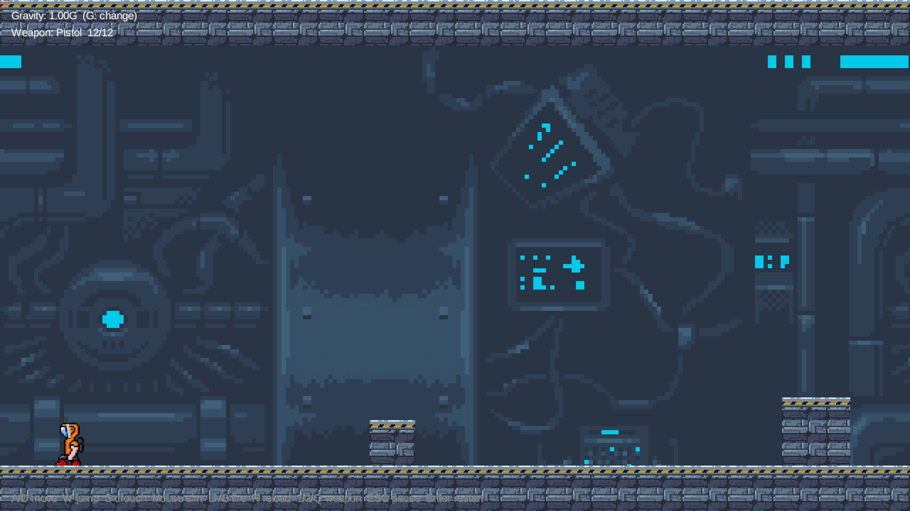
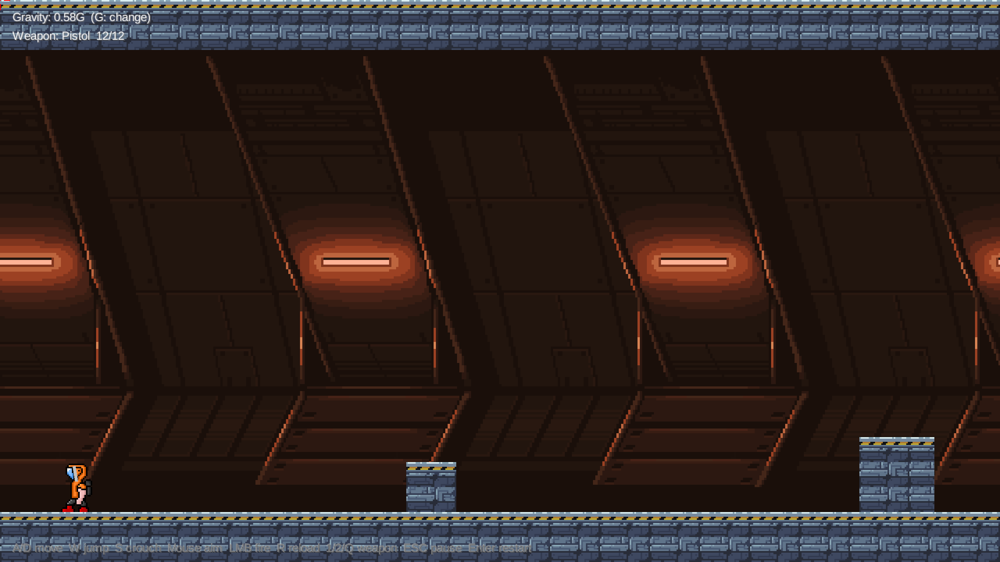
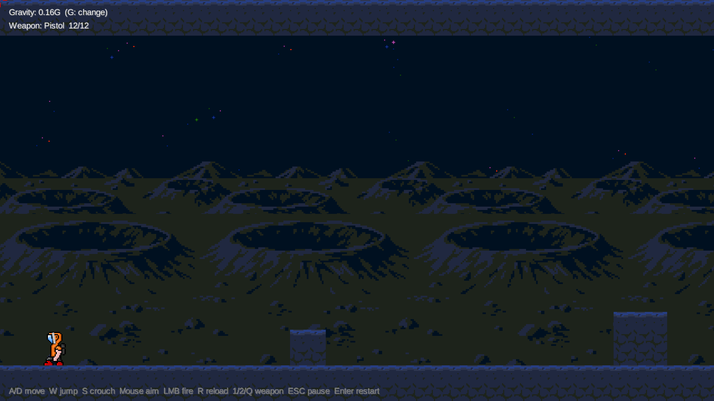
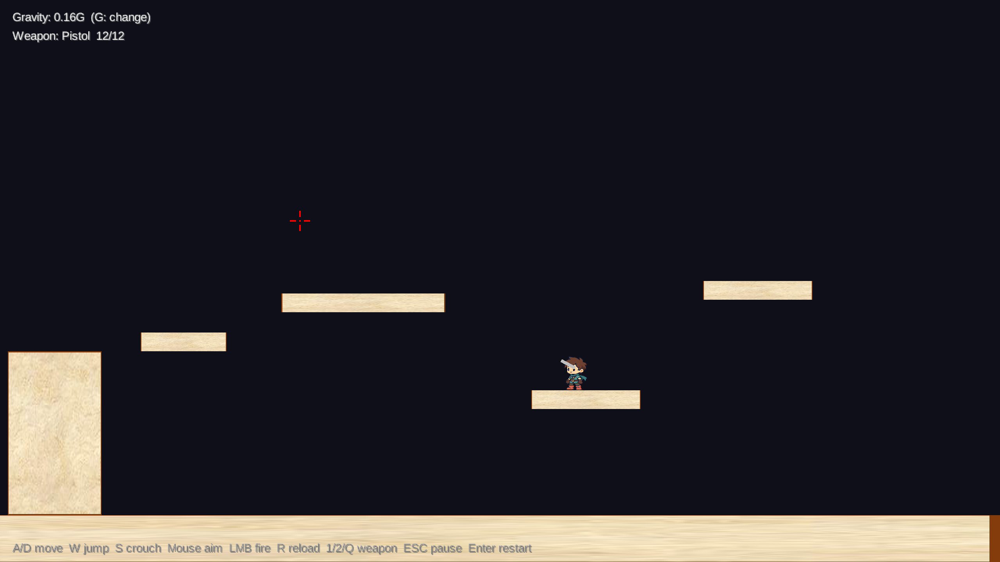
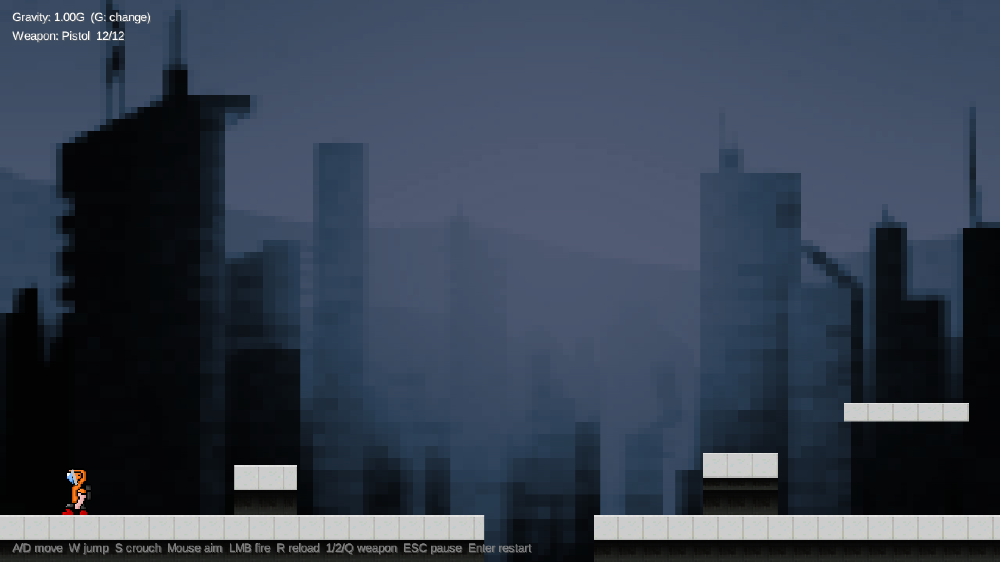
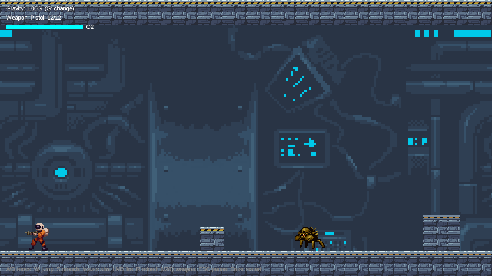
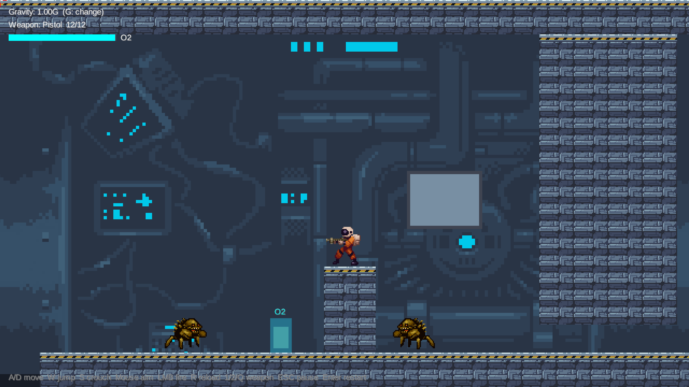
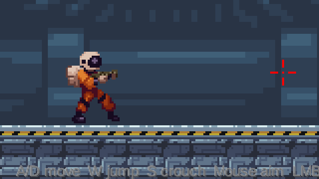
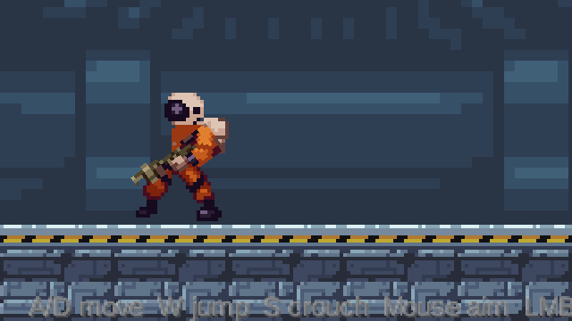

# 개발 일지 — 게임 및 혼합현실 중간 프로젝트

레포트·발표 자료용 기록. 결정한 것, 그 이유, 확인한 방법을 날짜순으로 남긴다.
계획과 일정은 [PLAN.md](../PLAN.md), 실행 방법과 에셋 출처는 [README.md](../README.md).

- 과제: LibGDX 2D 플랫포머 (레벨 3개 15%, 카메라 10%, 독창 요소 3개 40%, 일시정지 5%, 구현 수준 20%, 게임 디자인 10%)
- 제출: 11/9 LMS (발표자료, 깃허브 링크, 레포트, 유튜브 시연영상) / 발표·데모: 11/10

---

## 1. 게임 개요

**장르:** 2D 런앤건 플랫포머 (메탈슬러그 계열)
**스토리:** 달 연구기지에서 연구하던 주인공이 갑자기 들이닥친 괴물을 피해, 지구로 돌아갈 탈출포드까지 가는 여정.

| 스테이지 | 장소 | 중력 | 설정상 이유 |
|---|---|---|---|
| 1 | 연구동 | 1.0G | 기지 인공중력 정상 작동 |
| 2 | 붕괴 구역 | 0.58G = (1G + 달)/2 | 인공중력 고장 중 |
| 3 | 달 표면 → 탈출포드 | 0.16G | 기지 밖, 달 중력 그대로 |

### 독창 요소 3개 (코드 구현)
1. **중력 연동 반동 무기** — 권총(반동 작음, 데미지 약함) / 샷건(반동 큼, 펠릿 5발). 반동은 조준 반대 방향의 고정 충격량이라, 같은 샷건이라도 중력이 약할수록 높이 뜬다 (높이 = v²/2g). 앉으면 반동 50%.
2. **산소 = 체력 + 누출** — 피격 시 산소 감소 + 우주복 누출 단계 증가, 누출은 진공에서만 산소를 뺌. 산소 스테이션에서 충전·수리.
3. **감압 창문** — 창문 내구도를 맞은 탄 수만큼 깎음. 권총(1발)으로는 잘 안 깨지고 샷건(5발)은 2발에 깨짐 → 깨지면 흡입력 발생.

### 조작 (서든어택 방식)
A/D 이동 · W 점프 · S 앉기 · 마우스 조준 · 좌클릭 사격 · R 재장전 · 1/2/Q 무기 전환 · ESC 일시정지 · Enter 재시작 · F12 스크린샷 · G 중력 전환(테스트용)

---

## 2. 기획 과정 (왜 이 게임인가)

### 2-1. 첫 컨셉: REWIND (시간 조작) → 폐기
- 처음에는 되감기·고스트 리플레이·시간 구역을 독창 요소로 하는 퍼즐 플랫포머를 기획했다.
- 하고 싶은 게임이 **총 쏘는 2D 게임(메탈슬러그류)**이라서 방향을 바꿨다.

### 2-2. 런앤건 컨셉 검토 (냉정한 평가)
- 강의 로직(중력, `Rectangle` 충돌, 재시작)으로 이동·총알·적·재시작을 모두 만들 수 있어 **구현 가능성은 높음**. 강의에 없는 것은 스프라이트 애니메이션(`Animation<TextureRegion>`)과 마우스 좌표 변환(`viewport.unproject`) 정도.
- 처음 아이디어(스테이지마다 중력 상수만 다름, 산소 게이지)는 **독창 요소로 약함**: 상수 하나 바꾸는 것은 "레벨 차이"로 보일 위험, 산소 게이지는 흔한 장치. → 중력이 **전투(반동)**에 영향을 주도록, 산소를 **체력 겸 자원**으로, 세 번째 요소로 **감압 창문**을 추가.
- 세 요소가 모두 "무기 선택"으로 이어지도록 정리: 샷건은 이동기(반동 점프)이자 창문을 깨는 위험 요소.

### 2-3. 비슷한 게임 조사 (레포트 "참고한 게임" 절)
| 요소 | 비슷한 게임 | 우리 게임의 차이 |
|---|---|---|
| 샷건 반동 이동 | Out Recoiled, Shotbun, Recoil Mania, Kickback, Sacre Bleu, Shotgun Cop Man | 같은 반동이 **스테이지 중력에 따라** 다른 결과, 앉으면 반동 감소 |
| 달 기지 탈출 + 산소 | MoonLess, Lunar Escape(itch.io) | 산소가 체력 겸용, 피격 시 누출, 진공에서만 소모 / 중력이 단계적으로 약해지는 설정 |
| 감압 | Evacuation (2009 플래시 퍼즐) | 2D 슈팅에서 **무기(펠릿 수)에 따라 창문 파괴 속도**가 달라짐 |
| 세 요소의 조합 | 찾지 못함 | 무기 하나의 선택이 이동·전투·환경 위험에 모두 영향 |

---

## 3. 강의 로직 사용처 (배점 "요구사항 충족"의 근거)

| 강의 내용 | 우리 코드 | 바꾼 점 |
|---|---|---|
| 12장 `moveX` → `moveY` 분리 충돌, 착지·머리 충돌, `grounded` 매 프레임 재계산 | `Body.moveX()`, `Body.moveY()` | 플레이어·적이 같은 `Body`를 공유하도록 클래스로 분리 |
| 12장 중력 `velocityY = max(velocityY - GRAVITY*dt, -900)` | `Body.applyGravity(gravity, dt)` | `GRAVITY` 상수 → 스테이지별 중력 값 (1G = 강의 값 1700) |
| 12장 `dt = min(delta, 1/30)` | `Main.render()` | 그대로 |
| 12장 키 입력 → 속도, `isKeyJustPressed` 점프 | `World.update()` | 키를 서든어택식(WASD)으로, 이동 속도 260 → 200 (플레이테스트) |
| 12장 `overlaps(flag)` 목표 판정 | `World.update()` 5단계 | 깃발 → 출구 |
| 과제2 낙사 복귀·Enter 재시작 | `World.reset()`, `Main.input()` | 위치뿐 아니라 탄약·총알·상태 전체 초기화 |
| 과제2 카메라 X축 추적 + `clamp` | `CameraManager.update()` | Y축 추적 추가, 순간이동 대신 부드럽게 따라감 |
| 10장 `CameraManager` 흔들림(감쇠 + 랜덤 오프셋) | `CameraManager.startShake()` | 연사 시 더 센 흔들림이 이기도록 변경. 샷건·권총 발사, 클리어 시 사용 |
| 10장 `GameState` + `endingCheck()` | `Main.endingCheck()` | PLAYING / PAUSED / CLEARED, ESC 일시정지 |
| 10장 "World는 로직, CameraManager는 연출, delta는 Main" | `Main` / `World` / `CameraManager` 분리 | 그대로 따름 |

### 강의에 없는 구현 (배점 "구현 수준 20%")
- 마우스 360° 조준: `viewport.unproject()`로 화면 좌표 → 월드 좌표
- 반동 물리: 위로 미는 반동은 `max(vy, kick)`로 처리해 연사로 무한 상승하지 않고, 도달 높이가 항상 v²/2g
- 반동 수평 성분은 별도 속도(`kickX`)로 두고 마찰로 감쇠 (땅 10/s, 공중 1.5/s) — 강의 방식(매 프레임 `velocityX`를 입력으로 덮어씀)과 공존시키기 위함
- 앉기: 히트박스 축소 + 머리 위가 막히면 못 일어남 (`overlaps()` 재사용)
- 스프라이트 애니메이션, 패럴랙스 배경, 타일 잘라 그리기, 별 무작위 배치
- `Art` 클래스: 모든 그림 설정을 한 파일로 모음 (프레임 수 자동 인식)

---

## 4. 검증

### 4-1. 반동 높이 (`core/src/test/java/io/jbnu/game/RecoilHeightCheck.java`)
실제 `Body` 이동 코드로 1/60초 스텝 시뮬레이션. 기대값 v²/2g와 8% 이내면 통과 → **통과**.

| 반동 높이 (월드 단위) | 1.0G | 0.58G | 0.16G |
|---|---|---|---|
| 샷건 (v=500) | 69.4 | 122.6 | 455.4 |
| 권총 (v=80) | 1.3 | — | 11.1 |

이론값보다 3~5 낮은 이유: 강의에서 설명한 대로 점프 첫 프레임에도 중력이 먼저 적용되기 때문.

### 4-2. 맵 설계 수치 (1스테이지)
- ④ 벽 높이 160: 1G 점프(약 119)로는 못 넘고, 점프 + 샷건 반동(약 69 → 합 약 188)으로 넘는다.
- ⑤ 낮은 통로 틈 52: 서 있으면(높이 60) 막히고, 앉으면(44) 통과.
- ③ 구덩이 112: 1G 점프 체공 약 0.76초 × 이동 200 = 약 153까지 건널 수 있음.

### 4-3. 화면 확인
`-Dautoshot`으로 세 분위기를 자동 캡처해 확인. 처음 캡처에서 발견해 고친 문제:
- 깃발이 검은색이라 어두운 배경에 묻힘 → 흰 실루엣으로 바꾼 뒤 색 입힘 (`Art.whiteSilhouette`)
- 달 배경: 별 타일 반복 무늬 → 무작위 배치 / 크레이터 레이어가 산을 가림 → 먼 레이어를 위로 / 별 타일의 불투명 바탕 → 하늘색을 타일 바탕색과 일치

| 1 연구동 | 2 붕괴 구역 | 3 달 표면 |
|---|---|---|
|  |  |  |

---

## 4-4. 버전별 변화 (레포트용 스크린샷)

git 태그로 각 단계를 남겼다. **v0.1과 v0.2는 git 저장소를 만들기 전 단계라, 이 일지를 바탕으로 나중에 재현한 버전이다** (`snapshot/*` 브랜치). 스크린샷은 `docs/images/history/`.

| 태그 | 단계 | 주요 내용 | 스크린샷 |
|---|---|---|---|
| `v0.1-prototype` | 강의 로직 이식 + 무기 프로토타입 | 강의 Project2 이미지·블록 배치, 반동 테스트 탑(발판 220/360/1060), 마우스 방향 회전 막대 총, 이동 260 |   |
| `v0.2-sprites` | 첫 CC0 스프라이트 | drakzlin 병사 애니메이션, Eris 타일, 도시 배경, 이동 200 / 문제: 깃발이 검어 안 보임, 도시 배경이 설정과 안 맞음 |   |
| `v0.3-first-commit` | 1스테이지 맵 + 스테이지별 분위기 | 튜토리얼식 연구동 맵, Foozle 타일 + ansimuz 배경 + Lunar 달 표면, 깃발 수정, F12 스크린샷 | 4-3의 세 장 |
| (작업 중) `feat/crawler-enemy` | 적·피격 | 스페이스 마린(총 든 모션), 크롤러 외계인, 피격·피 효과, 산소 게이지 |  |

### 예전 버전 실행하기
지금 작업 폴더를 건드리지 않고, 옆 폴더에 예전 버전을 꺼내서 실행한다.

```bash
git worktree add ../v0.1 v0.1-prototype
```

```bash
cd ../v0.1 && ./gradlew lwjgl3:run
```

다 보면 지운다 (브랜치와 태그는 남는다).

```bash
git worktree remove ../v0.1
```

---

## 5. 에셋 선정 (모두 CC0 — 깃허브 공개·포트폴리오 사용 가능)

교수님 안내: "과제에서는 다른 게임 스프라이트를 써도 되지만, 깃이나 포트폴리오에 올릴 땐 조심할 것" → 제출에 깃허브 링크가 포함되므로 **처음부터 재배포 가능한 CC0 에셋만** 사용.

| 용도 | 에셋 | 고른 이유 / 뺀 후보 |
|---|---|---|
| 주인공(초기) | Space soldier 32x32 (drakzlin) | 앉기 포함 애니메이션 / 유료 Pixxiland 병사는 재배포 금지라 제외 |
| 주인공(현재) | ansimuz 스페이스 마린 | 주황 우주복 + **소총을 든 채** 대기·달리기·점프·사격(총구 화염)·사망. 달 탈출 우주인 설정과 맞음 |
| 크롤러 | ansimuz 걷는 외계인 | 같은 작가라 마린과 그림체 일치, 걷기·대기 애니메이션 |
| 지형 | Foozle Sci-fi Lab Tileset | 연구소 분위기 32px 타일 |
| 실내 배경 | ansimuz Sideview Sci-Fi Collection | 실내 장면 여러 개 → 1·2스테이지를 다르게 |
| 달 표면 | Lunar Battle Pack (Matt Walkden) | CC0 중 유일한 횡스크롤 달 지평선 레이어 / drakzlin moon background는 탑뷰라 제외 |
| 제외 | Space Station Pixel Art Backgrounds | 유료, 라이선스 미표기 |
| 제외 | Spaceship Interior, Server Room | 사진·3D 렌더 풍이라 픽셀아트와 안 맞음 |

"구멍 난 기지" 이미지는 CC0에서 찾지 못함 → 감압 창문 구현 시 실내 배경 위에 별 배경을 합성해서 표현할 계획.

---

## 6. 날짜별 진행

### 10/20 (화)
- 과제 PPT·강의자료(10장 Camera Dynamics, 12장 Platformer Final, Project2 코드) 분석
- 컨셉 결정: REWIND → 런앤건, 독창 요소 3개 확정, 조작 방식 확정, 비슷한 게임 조사
- 프로젝트 생성 (강의 Project2의 Gradle 구성 재사용, 패키지 `io.jbnu.game`)
- 강의 로직 이식 + 구조 분리 (`Main` / `World` / `Body` / `CameraManager` / `Weapon`)
- 마우스 조준, 권총·샷건, 반동, 재장전, 앉기, 일시정지, 재시작, 카메라 흔들림
- 반동 높이 검증 코드 작성·통과
- 플레이테스트 피드백: 조작감 괜찮음, 이동이 빠름 → 260 → 200
- 1스테이지 맵 재설계 (튜토리얼식: 점프 → 계단 → 구덩이 → 샷건 벽 → 앉기 통로 → 출구)
- CC0 에셋 적용, 스테이지별 배경·지형 3종, F12 스크린샷

### 10/20 (화) — 이어서
- git 저장소 생성, 첫 커밋 (main), 이후 작업은 `feat/crawler-enemy` 브랜치
- **크롤러 적**: 순찰(벽·발판 끝에서 돌아섬) → 같은 높이 앞쪽 320 이내에 플레이어가 보이면 돌진(속도 60 → 190). 돌진 중에는 멈추지 않아 구덩이에 빠질 수 있음. 체력 3, 맞으면 빨갛게 번쩍이며 밀려남. 플레이어와 같은 `Body`(강의 충돌 로직)를 써서 중력·낙사도 똑같이 적용.
- **피격**: 적과 닿으면 산소 −20, 적 반대쪽으로 튕겨남, 1초 무적(깜빡임), 카메라 흔들림. 산소 0 → 사망 모션 1.5초 → 재시작. HUD에 산소 게이지(30% 미만 빨강).
- **피 효과**: 맞을 때마다 피 방울 파티클(플레이어 빨강, 외계인 녹황색). 방울도 **스테이지 중력**을 받아 달에서는 천천히 흩날리고, 블록에 닿으면 그 자리에 자국으로 남았다가 사라짐.
- **총 든 모션**: 처음 쓰던 병사 스프라이트는 소총 든 프레임이 정면 고정이라 360° 조준과 맞지 않았음 → 같은 CC0 팩의 **스페이스 마린**으로 교체. 항상 소총을 든 모습이고, 쏠 때 총구 화염 모션이 나옴. 회전하는 막대 총은 제거.
- 검증: `EnemyCheck` 4항목 통과 (발판 끝에서 돌아섬 / 돌진 / 돌진 중 구덩이 낙하 / 3발에 사망). 처음엔 ③이 실패했는데, 코드가 아니라 테스트 조건 문제(플레이어를 구덩이 앞에 둬서 적이 지나치는 순간 돌진이 풀림)였고 플레이어를 건너편에 두도록 고침.

### 10/20 (화) — 2주차 작업 앞당김 (`feat/oxygen-decompression`)
- **산소 소모 규칙** (`World.oxygenDrain`)

  | 위치 | 초당 소모 |
  |---|---|
  | 기지 안 (1G·0.58G, 창문 멀쩡) | 0 (누출이 있어도 안 줄어듦) |
  | 달 표면 (0.16G) | 2 + 누출 단계 × 3 |
  | 창문이 깨진 방 | 8 + 누출 단계 × 3 |

- **누출**: 적과 닿을 때마다 누출 단계 +1 (최대 3). HUD에 `SUIT LEAK x단계`.
- **산소 스테이션**: 서 있으면 초당 40 충전 + 누출 0으로 수리. 1스테이지에 2개 (샷건 벽 앞, 앉기 통로 뒤).
- **붉은 화면**: 산소 30% 미만에서 화면 가장자리가 맥박치듯 붉어짐. 산소가 적을수록 진함.
- **감압 창문** (`Window`): 내구도 10, 맞은 탄 1발당 1 감소 → 무기별 예외 처리 없이 펠릿 수만으로 "권총 10발 / 샷건 2발" 차이가 생김. 균열 3단계 표시. 깨지면:
  - 방 전체가 진공 → 산소 소모 시작
  - 창문 쪽으로 흡입 가속도 900 (앉으면 절반 → 앉기에 "버티기" 의미 추가)
  - 외계인은 버티지 못하고 끌려가 창문으로 빨려 나감
  - 깨진 창 안쪽에 달 표면 배경의 별 타일을 합성 → CC0에서 못 찾은 "구멍 난 기지" 그림을 코드로 해결
  - 유리 파편 파티클, 카메라 강한 흔들림
- **총알 관통 문제 수정**: 총알 이동을 한 번에 8px 이하로 나눠 충돌 검사 (한 프레임 최대 약 47px 이동 → 24px 발판·창문을 뚫던 문제)
- 검증: `OxygenWindowCheck` 통과 (소모량 4가지, 권총 10발/샷건 2발, 균열 단계). 기존 `EnemyCheck`, `RecoilHeightCheck`도 통과.
- 화면 확인: 자동 스크린샷에 창문 3단계·산소 부족 장면 추가. 처음 캡처에서 붉은 테두리가 거의 안 보여(투명도 최대 7%) 진하게 수정 (최대 45%).

| 창문 멀쩡 | 균열 | 깨짐 (별 합성, 외계인 흡입) | 산소 부족 |
|---|---|---|---|
|  |  |  |  |

### 10/20 (화) — 플레이테스트 피드백 반영 (`feat/aim-arms-map`)
피드백: ① 창문이 하나뿐 ② 무기를 바꿔도 캐릭터 그림은 그대로 ③ 조준점은 움직이는데 팔은 가만히 있음 ④ 맵이 너무 단순함

- **②③ 팔·총 분리 회전**: 마린 스프라이트는 총이 몸에 그려져 있어서, 불러올 때 코드로 나눔
  - 대기 프레임을 픽셀 단위로 분석해 어깨 앞쪽 띠(8행: 팔뚝·장갑·소총)의 위치를 찾음
  - 대기·달리기·점프 프레임마다 헬멧 꼭대기 픽셀로 흔들림(위아래 0~2px)을 맞춰 그 띠를 지움 → 팔 없는 몸
  - 대기 프레임에서 띠를 오려 "팔+총" 조각을 만듦: 샷건 = 소총 전체(19px), 권총 = 총신을 자른 것(13px)
  - 어깨를 축으로 조준 각도만큼 회전해 그림. 왼쪽을 볼 땐 위아래를 뒤집어 총이 거꾸로 서지 않게 함
  - 총알도 같은 어깨·각도·총 길이에서 나감 → 그림과 총알 방향이 일치. 쏠 때 총구 화염
  - 원래 쓰던 "사격 모션"(소총이 그려진 프레임)은 회전 팔과 겹쳐서 제거
- **①④ 맵 재설계**: 4800 × 820, 창문 3개, 산소 스테이션 3개, 크롤러 7마리 (→ 피드백 2에서 720 높이, 16마리로 조정)
  - A 시작 연구실 → B 계단 실험실(창문) → 위층 통로(구덩이 위) / 아래 길(구덩이 점프) 갈림 → D 샷건 벽 → E 창문 방 → F 앉기 통로 → G 계단 → 위쪽 통로(안전) / 아래쪽 방(창문 + 적 2) 갈림 → H 출구
  - 처음 재설계 때 천장을 1016으로 높였더니 위쪽 절반이 비어 보여서 756으로 낮추고 위층 통로를 추가
- 검증: 기존 검사 3개 통과, 자동 스크린샷에 조준 고정 장면(권총 오른쪽 / 샷건 위 / 샷건 왼쪽 아래)과 맵 전체 장면 추가

| 권총, 오른쪽 | 샷건, 위 | 샷건, 왼쪽 아래 |
|---|---|---|
|  |  |  |

### 10/20 (화) — 플레이테스트 피드백 2
피드백: ① 팔을 위아래로 돌리면 원래 팔 아랫부분 픽셀이 몸에 남음 ② 맵 세로가 너무 넓음 ③ 적이 너무 적음 ④ 창문이 적과 떨어져 있어 의미가 약함

- **① 원인**: 몸 앞쪽 팔(주황 소매)은 어깨(x 8~9)에서 시작해 손까지 이어지는데, x 15부터만 잘라 소매 아랫부분이 몸에 남았음
  → 팔 조각을 어깨(x 8)부터 오리고, 회전축도 진짜 어깨(x 9, 위에서 21.5)로 옮김. 팔이 빠진 몸통 자리는 원래 윤곽 안쪽만 몸통 색으로 메워 구멍이 안 생기게 함
  → 달리기 프레임은 몸이 2px 낮아 팔이 떠 보일 수 있어, 프레임마다 기록한 어깨 위치에 팔을 붙임
- **② 맵 높이** 820 → 720 (천장 656). 화면 높이와 같아 카메라는 가로로만 움직임
- **③ 적** 7 → 16마리. 바닥뿐 아니라 선반·계단·위층 통로·위쪽 통로 위에도 배치
- **④ 창문 위치**: 3개 모두 적이 다니는 바닥 높이(y 80~176)로 내리고 적 무리 바로 뒤에 둠
  → 적을 향해 쏘다 빗나간 탄·샷건 펠릿이 창문을 깸. 샷건으로 쓸어버릴지, 권총으로 조심히 쏠지 고르게 됨
  → 깨지면 창문 앞 적이 바로 빨려 나감. 높은 창문용으로 넣었던 "적을 위로 띄우는" 처리는 필요 없어져 제거

| 팔 위 (자국 없음) | 팔 왼쪽 아래 | 창문 깨진 직후 (적 흡입) |
|---|---|---|
|  |  |  |


---

## 7. 남은 일 / 알려진 문제
- [x] 크롤러 적 + 피격 + 피 효과
- [x] 산소 = 체력 + 누출, 산소 스테이션
- [x] 감압 창문 (내구도, 흡입, 별 배경 합성)
- [ ] 숨소리 효과음 (사운드 작업 때)
- [ ] 창문 3개가 지금 1스테이지 맵에 있음 → 스테이지 분리 시 2스테이지 위주로 재배치
- [x] 소총이 항상 수평이라 총알 방향과 그림이 다름 → 팔·총 분리 회전
- [ ] 팔 조각을 크게 돌리면(위·아래 끝) 어깨 쪽 이음새가 살짝 보임
- [x] 팔을 돌리면 원래 팔 아랫부분이 몸에 남던 문제 → 어깨부터 오리고 몸통 색으로 메움
- [ ] 마린 스프라이트에 앉기 모션이 없어 대기 모션을 세로로 75% 눌러 그림 (임시)
- [ ] 드로퍼·스피터 적
- [ ] 스테이지 2·3 맵, 스테이지 전환, 전체 클리어 화면
- [x] 총알이 얇은 발판(24px)을 뚫던 문제 → 이동을 8px 단위로 나눠 검사
- [ ] 배경 픽셀 배율(3~6배)이 캐릭터·지형(2배)보다 커서 배경 픽셀이 더 굵어 보임 (거리감으로 수용 중)
- [ ] 3스테이지에도 1스테이지 맵의 천장이 보임 (스테이지 분리 시 해결)
- [ ] 깃발 → 탈출포드 그림 교체
